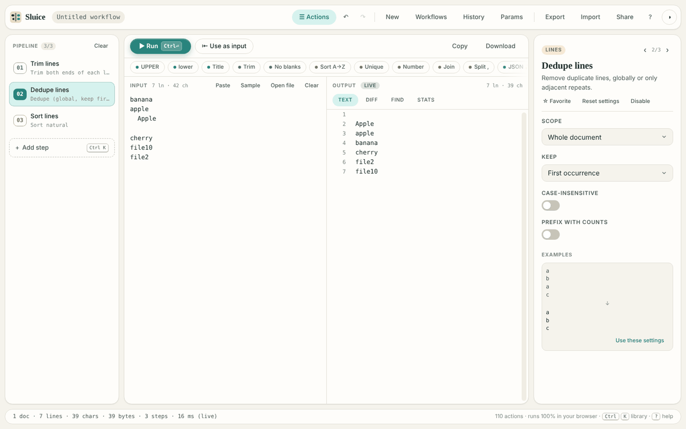

# Sluice

A local-first text workbench. Paste text, click a tool, copy the result. Or chain tools into a saved pipeline you can run again. It runs 100% in the browser: no server, no uploads, no tracking.



**Try it:** https://text-tools-kohl.vercel.app

## What it does

**110 tools in 12 categories**
- **Text:** case, Unicode, quotes, padding, wrapping.
- **Whitespace:** trim, indent, tabs, blank lines.
- **Lines:** sort, dedupe, filter, number, list.
- **Find and replace:** replace, highlight, count matches.
- **Extract:** emails, URLs, numbers, columns, HTML.
- **JSON and CSV:** format, validate, convert, reshape.
- **Encode:** Base64, URL, HTML, hex, JWT, hashes.
- **Split:** cut one document into many.
- **Merge:** join, zip, interleave documents.
- **Generate:** sequences, UUIDs, lorem, lists.
- **Analyze:** stats, frequency, diff, regex test.
- **Flow:** select, rename, batch, assert, script.

**Quick use**
- A quick bar of one-click chips for common tools, plus your starred favourites. Shift+click applies a tool straight to the input.
- The action library (`Ctrl/⌘ K`) is a three-column browser with a category rail, ranked search over names, categories and synonyms ("unique" finds Dedupe, "grep" finds Filter), and a live before and after preview on your own input.
- "Use as input" moves the output into the input and clears the steps, so you can chain quick edits.

**Pipelines**
- Each tool is a step with its own settings. Steps can be disabled, reordered and edited, and each card shows a one-line summary of its settings.
- Live preview processes inputs up to 256 KB in full as you type. Larger inputs fall back to a labelled sample preview.
- Output views: Text, Diff, Find and Stats. Several documents can be open as tabs.
- 8 ready-made recipes: clean a list, unique emails, IDs to SQL `IN (…)`, CSV to Markdown, top words, LLM chunking, clean pasted prose, inspect a JWT.
- Saved workflows with run history and workflow parameters. Workflows export to and import from files.
- Undo and redo, with undo toasts on every destructive action.
- Share links carry the whole workflow in the URL fragment, compressed. Including the input text is optional, up to 20,000 characters. Every operation and parameter in a link is checked by the same rules as file import.
- The `script` step runs your own JavaScript in a sandboxed sub-worker with network APIs removed.

**Around it**
- Light and dark themes. The favicon, logo and theme colour follow the theme.
- Keyboard shortcuts, with a `?` help sheet. Semantic landmarks, ARIA on the palette, and reduced-motion support.

## What it does not do

- Exporting multiple docs as a ZIP or separate files (only "copy all" and "download .txt" exist).
- Previewing on a sample whose size the user can set, and streaming for inputs above about 50 MB.
- Drag-and-drop from the library onto a specific position in the pipeline.
- Real keyboard reordering inside the library, and user-defined custom quick-bar order.
- It has no server, no accounts and no sync. Workflows and history stay in the browser that made them.

## Privacy

Nothing is uploaded and nothing is tracked. The Content Security Policy limits requests to the app's own origin, and the app has no backend. What it stores in your browser:
- IndexedDB `sluice`: saved workflows, run history, the current workflow and preferences.
- `localStorage`: the input draft, the theme, favourites (`sluice.favorites`) and recent tools (`sluice.recent`).

Share links hold their data in the URL fragment, which browsers never send to a server.

## Built with

- **No dependencies, no build step.** Plain ES modules and CSS tokens. Each tool is one module in `src/ops/`, loaded on demand.
- **Web Workers.** The pipeline runs in a module worker with a content-hash cache. The `script` step runs in a sub-worker with network APIs removed.
- **Tests run in the browser:** `tests.html` (291 tests) and `e2e.html` (38 tests, driving the real app in an iframe). Both pass.

## Run locally

```
python3 -m http.server 8000
```

Then open `http://localhost:8000`.

## Entry points
| Path | Purpose |
|---|---|
| `index.html` | The app |
| `index.html?e2e` | Ephemeral mode: storage is in memory only, and `window.__sluice` is exposed (used by the tests) |
| `index.html#w=<token>` | Opens a shared workflow |
| `tests.html` | Unit + operation suite: **291 tests** |
| `e2e.html` | End-to-end UI suite, driving the real app in an iframe: **38 tests** |
| `smoke.html` | Worker smoke test |
| `demo*.html`, `icon-preview.html` | Pre-staged UI states (light/dark, palette, mobile) and icon sizes for visual QA. Safe to delete before shipping. |

## Testing
- **Core**: schema coercion/validation, workflow (de)serialization and rejection of bad files, `$param` resolution, history, store, hash, Myers diff, escape helpers.
- **Catalog integrity**: every op matches its manifest, has a unique id, a known category, keywords, a well-formed param contract (enum defaults are valid), and a `describe()`. Every quick action and recipe points at real ops and params. Search relevance checks (e.g. "unique" → Dedupe in the top 3).
- **Every op's documented examples.**
- **Robustness**: every op runs on 12 adversarial inputs (empty, CRLF/CR, BOM, emoji/RTL/CJK, NUL and zero-width, quoted CSV, HTML, Markdown). Ops are checked for purity (input not mutated) and map-arity (doc count preserved).
- **Behavior**: all case modes, dedupe/sort/filter modes, regex replace with groups and nth-match, split/merge, encoder round-trips with Unicode for 7 encoders, CSV↔JSON round-trip, graceful degradation on bad input, a 200k-line stress test, and seeded reproducibility for UUID and sampling.
- **Engine**: chaining, disabled steps, cache keys, error attribution and stop, unknown ops, sample-mode hints, workflow params plus overrides, cancellation, and every recipe running end-to-end with exact expected outputs.
- **E2E UI**: boot, quick chips, Shift-apply plus undo, bake plus undo, palette (open, category filter, Alt+Arrow, search ranking, preview, Enter/Shift+Enter, Alt+S favorites, Recent, Esc behavior, recipes), inspector editing with `\n` escapes, reset, undo/redo, E/Del keys with undo, clear, Ctrl+Enter run, Diff/Stats/Find views, error flagging, split doc tabs, save to library, rejecting an invalid import, `?` help, theme.

## Architecture & data
- `src/ops/**`: one module per operation (`run(docs, params, ctx)`, plus `params`, `examples` and `describe`), lazy-loaded through `src/ops/index.js`.
- `src/core/catalog.js`: categories, search keywords, quick actions, recipes, ranked search.
- `src/core/prefs.js`: favorites and recents in `localStorage` (`sluice.favorites`, `sluice.recent`).
- `src/core/env.js`: storage wrapper. `?e2e` switches it to memory only.
- `src/worker/*`: the pipeline runs in a module Web Worker with a content-hash cache. `flow.script` runs in a sandboxed sub-worker with network APIs removed.
- IndexedDB `sluice` (stores `workflows`, `runs`, `prefs`): saved workflows, run history, current workflow. `localStorage`: the input draft and the theme.
- No backend or Table API is used. Everything stays on the device.

More: [`CHANGELOG.md`](CHANGELOG.md) · [`docs/ship-checklist.md`](docs/ship-checklist.md)

## License

MIT. See `LICENSE`.
